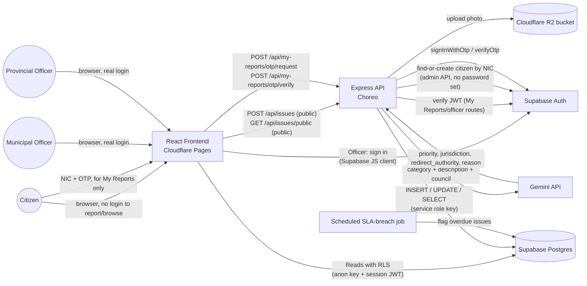
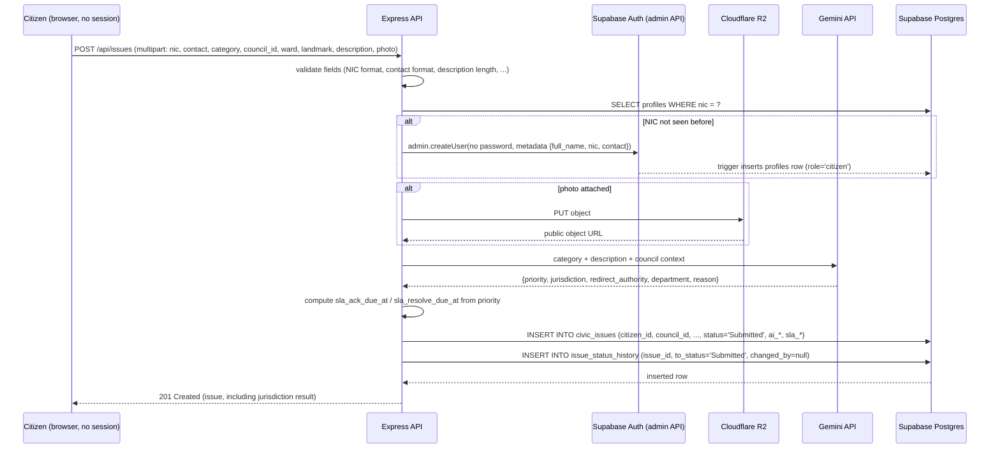
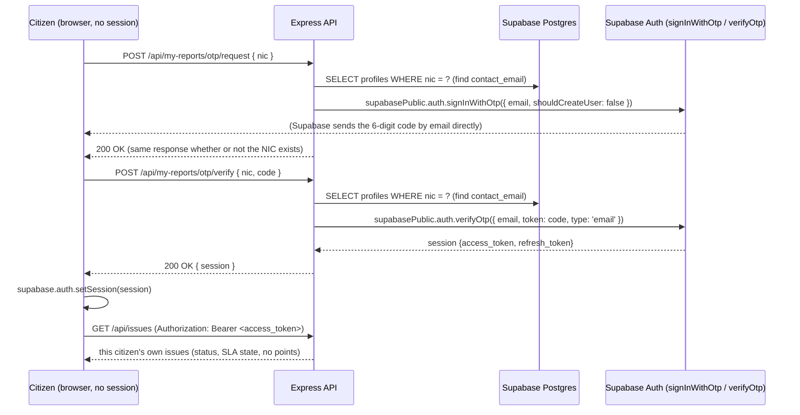
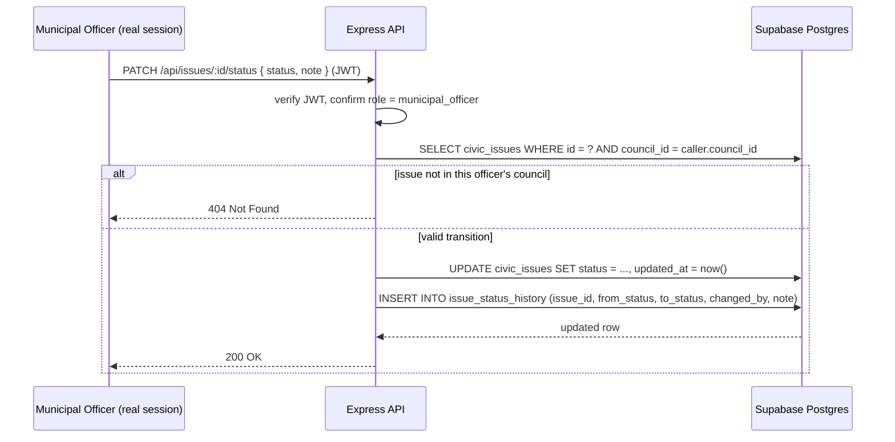
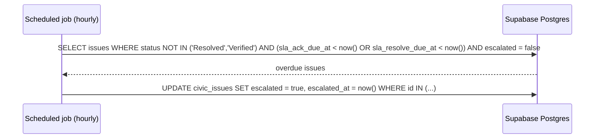
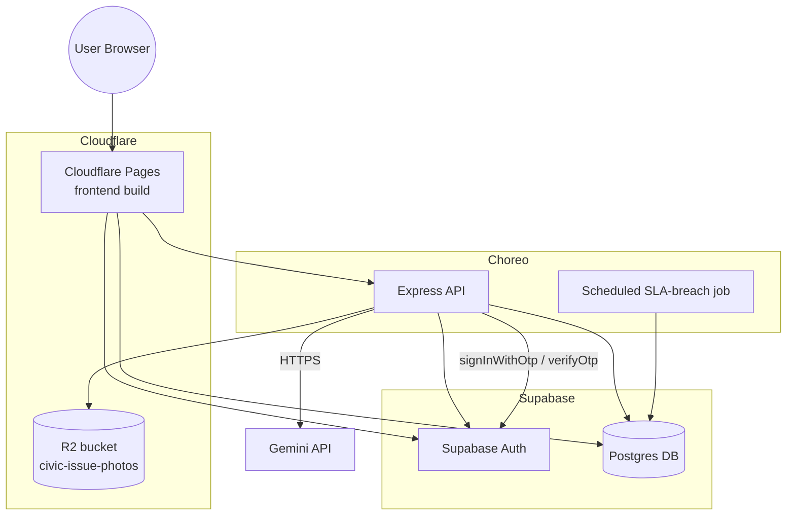

# 05 - System Architecture

## Stack summary

| Layer | Technology | Deployment |
|---|---|---|
| Frontend | React + Vite + Tailwind CSS | Cloudflare Pages |
| Backend API | Node.js + Express | WSO2 Choreo (fallback: Render) |
| Database + Auth | Supabase (PostgreSQL + Supabase Auth) | Supabase-hosted |
| File storage | Cloudflare R2 (S3-compatible) | Cloudflare-hosted, public bucket |
| AI | Google Gemini API | Called server-side from Express |
| OTP delivery (v1) | Supabase Auth's own passwordless email OTP | No new vendor, no new table, Supabase generates, sends, and verifies the code, see [`06-data-model.md`](06-data-model.md#citizen-otp-no-otp_codes-table-supabase-auth-handles-it-natively). SMS is a Phase 2 item, [`04-scope-and-boundaries.md`](04-scope-and-boundaries.md). |

Stack is unchanged from the original design - this redesign is a workflow/role/data-model change, not a technology change (see `CLAUDE.md`).

## System context

## Why this shape

- **The frontend never writes to Supabase directly.** All inserts/updates go through Express, which uses the Supabase **service role key**. This is also where R2 upload, Gemini triage (priority + jurisdiction), OTP generation/verification, and citizen/officer account provisioning happen.
- **Reporting and browsing require no session at all** - unchanged from the original design and a deliberate policy, not a gap. `POST /api/issues` and `GET /api/issues/public` are public routes. See [`03-governance-and-roles.md`](03-governance-and-roles.md#citizen-identity-what-stays-frictionless-and-what-changed).
- **Citizens never have a password.** "My Reports" access is a two-step OTP handshake (`request` → `verify`), not a sign-in with stored credentials. This closes the original design's NIC-as-password gap entirely, rather than hardening it.
- **Role checking happens server-side**, in Express, by verifying the caller's Supabase JWT and looking up role **and scope** (`council_id` for a Municipal Officer, `province_id` for a Provincial Officer) in the `profiles` table - never trust a role or scope claim sent from the client. A Municipal Officer's queries are always additionally filtered by their own `council_id`; a Provincial Officer's by their own `province_id`'s councils. See [`06-data-model.md`](06-data-model.md) for the RLS policies that back this up at the database layer too.
- **AI triage returns two judgments, not one** - priority and jurisdiction - and the jurisdiction result changes how the issue is queued (see below), not just how it's displayed.
- **SLA breach detection runs as a scheduled job**, not on every read - computing `sla_ack_due_at`/`sla_resolve_due_at` at submission time (a pure function of priority) means breach detection is just "is `now() > due_at` and status hasn't advanced," cheap to run on a timer (e.g. hourly) and cheap to query from the Provincial Officer dashboard afterward.

## Request flow: citizen submits an issue

## Request flow: citizen views "My Reports" (NIC + OTP)

Implementation note: this rides entirely on Supabase Auth's own passwordless email OTP, not a custom `otp_codes` table, see [`06-data-model.md`](06-data-model.md#citizen-otp-no-otp_codes-table-supabase-auth-handles-it-natively) for why.

## Request flow: Municipal Officer updates status

## Request flow: SLA breach escalation (scheduled)

The Provincial Officer dashboard reads `WHERE escalated = true AND council_id IN (their province's councils)` - no separate notification pipeline required for v1 (see [`04-scope-and-boundaries.md`](04-scope-and-boundaries.md) for notification delivery as a Phase 2 item).

## Deployment topology

## Key decisions & rationale

| Decision | Rationale |
|---|---|
| Reporting and browsing remain public, no-session routes | Deliberate policy carried forward, not a gap - see [`03-governance-and-roles.md`](03-governance-and-roles.md#citizen-identity-what-stays-frictionless-and-what-changed) |
| Citizens never have a password (OTP-only) | Closes the original NIC-as-password security hole completely, rather than hardening it |
| Role + scope (`council_id`/`province_id`) checked server-side, backed by RLS | Never trust a client-sent role or scope claim; a Municipal Officer's own `council_id` bounds every query they can make |
| Officer accounts provisioned top-down (System Admin → Provincial Officer → Municipal Officer), never self-registered | Mirrors the real appointment chain (a Commissioner is appointed, not self-signed-up) and removes an entire attack surface |
| AI triage returns jurisdiction alongside priority | A council's SLA metrics are only meaningful if issues that aren't theirs to fix don't count against them |
| SLA due-dates computed once, at submission, from a fixed priority→target table | Makes breach detection a cheap, deterministic query instead of recomputing "how urgent is this" on every read |
| Photo upload proxied through Express, not a presigned URL | Avoids CORS configuration and a two-step upload flow - not worth the complexity at expected volume |
| R2 bucket public read access | Photos are non-sensitive (public civic issues) |
| Contribution points removed entirely | Replaced by public SLA-transparency stats - see [`03-governance-and-roles.md`](03-governance-and-roles.md#public-transparency-replaces-citizen-contribution-points) |
